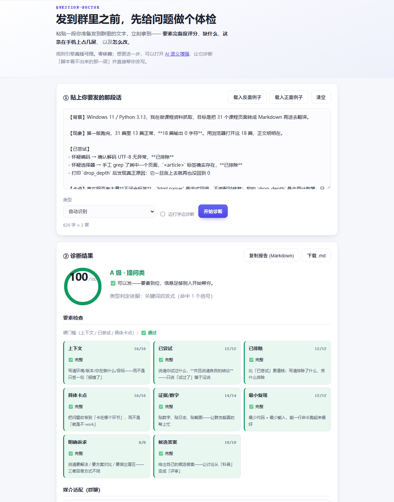

# question-doctor · 提问医生

> **一句话**：输入一段你准备发到群里的提问，输出一份「能不能发、缺什么、怎么改」的诊断报告。

<p>
  
  
  
  
  
</p>

**输入**：一段你准备原样发到群里的文字（提问 / 分享 / 回馈结论）
**输出**：要素完备度评分（0–100）+ 缺口清单 + 媒介适配检查（这条在手机上占几屏）+ 可直接照做的补法

---

## 解决什么问题

**「我在群里问了，但没人回。」**

大多数时候这**不是**因为群里没人，而是因为问题里**没有别人能用的信息**。
看看这个对比——两段话的技术内容**完全一样**，只是信息组织方式不同：

| | 输入 | 得分 |
|---|---|---|
| ❌ | `我的代码报错了，大佬们帮我看看` | **0 / 100**（D 级） |
| ✅ | `【背景】Windows 11 / Python 3.13……【现象】13 篇正常，18 篇输出 0 字符……【已尝试】试过换编码 → 无异常，已排除……【卡点】我怀疑是 drop_depth 计数器……【想请教】……` | **100 / 100**（A 级） |

**没有它之前**：你只能靠"感觉"判断这条写得行不行，发出去之后才知道没人回。
**有了它之后**：发之前跑一遍，30 秒知道缺什么；报告还会告诉你这一条在对方手机上占几屏。

它不判断你的问题"值不值得问"——只告诉你**信息够不够别人开始帮你**。

---

## 快速开始

### 安装

**零依赖**，不需要 `pip install` 任何东西。只需要 Python ≥ 3.9。

```bash
git clone https://github.com/makunhao/question-doctor.git
cd question-doctor
```

### 使用

```bash
# 1) 从管道读（推荐：直接把剪贴板过一遍）
Get-Clipboard | python scripts/question_doctor.py -      # Windows PowerShell
pbpaste       | python scripts/question_doctor.py -      # macOS
xclip -o      | python scripts/question_doctor.py -      # Linux

# 2) 从文件读
python scripts/question_doctor.py draft.md

# 3) 只要一个分数（适合接进脚本 / git hook）
python scripts/question_doctor.py --quiet draft.md
# → 94/100 (A) [提问类] 通过

# 4) 输出 JSON（给别的程序消费）
python scripts/question_doctor.py --json draft.md
```

**退出码即结论**：`0` = 可以发；`1` = 建议先改。所以它可以当门禁用：

```bash
python scripts/question_doctor.py draft.md || echo "先改改再发"
```

### 网页版（不用装 Python）

打开 👉 **https://question-doctor.app.workbuddy.host/**

粘贴文字，立刻看到同样的报告；还能一键复制 Markdown 报告 / 下载 `.md`。
`?demo=good` / `?demo=bad` 可以直接看正反两个示例。

---

## 示例

### 输入

```
我的代码报错了，大佬们帮我看看
```

### 输出（节选）

```
# 提问诊断报告  ·  0/100  (D 级)

| 要素       | 结果    | 得分   |
| 上下文     | ❌ 缺失 | 0/16  |
| 已尝试     | ❌ 缺失 | 0/12  |
| 已排除     | ❌ 缺失 | 0/12  |
| 具体卡点   | ❌ 缺失 | 0/16  |
| 证据/数字  | ❌ 缺失 | 0/14  |
| 最小复现   | ❌ 缺失 | 0/12  |
| 明确诉求   | ✅ 完整 | 8/8   |
| 候选答案   | ❌ 缺失 | 0/10  |

**硬门槛（上下文 / 已尝试 / 具体卡点）**：❌ 不通过 — 缺：上下文、已尝试、具体卡点

## 优先要补的
1. 上下文（16 分）— 补一句「环境 + 我在做什么 + 目标」
2. 具体卡点（16 分）— 把问题收窄到某个环节
3. 证据/数字（14 分）— 贴报错原文 / 日志，不要转述

## 负面信号
❌ 甩手式求助（-10）：「帮我看看 / 求个大神 / 谁会」——把定位问题的工作整包丢给了别人

结论：⚠️ 建议先按上面改一轮再发
```

> 它真正的问题**不是「太短」，而是「把定位问题的工作整包丢给了别人」**。
> 读的人要先问你 6 个问题才能开始帮忙——而群聊里没人愿意走这 6 步。



---

## 项目结构

```
question-doctor/
├── README.md
├── LICENSE                     MIT
├── CHANGELOG.md
├── CONTRIBUTING.md
├── CODE_OF_CONDUCT.md
├── AI_LOG.md                   AI 使用日志（含失败与迭代）
├── ATTRIBUTION.md              拿来说明：借鉴来源逐条登记
├── .gitignore
├── SKILL.md                    Claude Skill 主指令（可作为 .skill 安装）
├── scripts/
│   ├── question_doctor.py      核心引擎（CLI，零依赖）
│   └── build_web_rules.py      把规则同步成 web/rules.js（含权重校验）
├── references/
│   └── rules.json              ⭐ 全部规则：要素 / 权重 / 关键词 / 建议文案
├── web/
│   ├── index.html              网页版
│   ├── app.js                  UI + AI 层
│   ├── engine.js               规则引擎（JS 实现，与 Python 对拍）
│   ├── rules.js                由 build_web_rules.py 生成，请勿手改
│   └── styles.css
├── examples/
│   ├── 01-bad-question.md      反面例子（0 分）
│   └── 02-good-question.md     正面例子（100 分）
├── tests/
│   ├── test_question_doctor.py 22 个单元测试（含反例）
│   ├── test_parity.py          一致性对拍：Python 与 JS 必须给出同一个分数
│   └── engine_cli.js           Node 侧的对拍入口
└── .github/
    ├── workflows/ci.yml
    ├── ISSUE_TEMPLATE/
    └── pull_request_template.md
```

---

## 技术栈

- **语言**：Python 3.9+（零第三方依赖）／ 浏览器原生 ES2020（无构建步骤）
- **规则**：`references/rules.json` —— 单一事实来源，CLI 与 Web 共用
- **测试**：`unittest`（Python 标准库）+ Node 对拍
- **AI 集成**：网页版的可选「语义增强」层。默认走免密钥通道；
  未接通时可填自己的 OpenAI 兼容 Key（只存在浏览器 localStorage，不上传）
- **部署**：任意静态托管（本项目线上版为单页静态站点）

---

## 测试

```bash
python -m unittest discover -s tests -v
```

24 个测试，其中两个值得单独说：

- **`test_no_false_positive_on_real_content`** —— 反例：正文里出现「没有」「不行」
  **不能**被判成灌水。早期版本用 `"无" in cell` 判断「无回应」，
  把「你是不是**没有**在群里发」这条**真实回复**判成了「没人回」。
  **一个子串包含毁掉了一条证据**——现在这条被测试钉住了。
- **`test_parity.py`** —— Python 引擎与 JS 引擎必须对同一输入给出**同一个分数**。
  两套实现口径一旦漂移，用户会看到「网页说 90 分、命令行说 60 分」——那比没有工具更糟。
  这个测试上线当天就抓到了一个真实 bug：emoji 在 JS 里按 UTF-16 被算成 2 个字符。

---

## 改规则（不需要动代码）

所有判据都在 `references/rules.json`：

```jsonc
{
  "id": "具体卡点",
  "weight": 16,
  "note": "把问题收窄到「卡在哪个环节」",
  "patterns": ["卡在", "根因", "我怀疑"],
  "confirm": ["结果", "报错", "无效"]   // 可选：还要求同时出现这些词，否则只给一半分
}
```

改完跑两步：

```bash
python scripts/build_web_rules.py   # 同步到网页版（会校验权重是否仍合计 100）
python -m unittest discover -s tests
```

---

## AI 生成说明

本项目全程使用 AI 辅助开发（需求设计、代码、测试、文档、部署）。
完整的 AI 使用记录——**包括被 AI 带错方向、以及 AI 帮我抓到自己的盲点**——见 [AI_LOG.md](./AI_LOG.md)。

## 借鉴来源

借鉴了什么、从哪拿的、怎么改的，逐条登记在 [ATTRIBUTION.md](./ATTRIBUTION.md)。

## License

[MIT](./LICENSE)

---

## 谁在用它

> 这一节是给作者自己看的：这个工具的评判标准里，「被多少人真的用过」比「写得多漂亮」更重要。

| 日期 | 场景 | 结果 |
|---|---|---|
| 2026-10-02 | 作者自己在发群消息前自检 | 已用于本项目自身的 0 分 / 100 分两个示例 |
| （待补充） | | |

**用过了？欢迎在 [Issues](https://github.com/makunhao/question-doctor/issues) 里留一条**，
哪怕是「我觉得这个判定不对」——那是最有价值的反馈。
